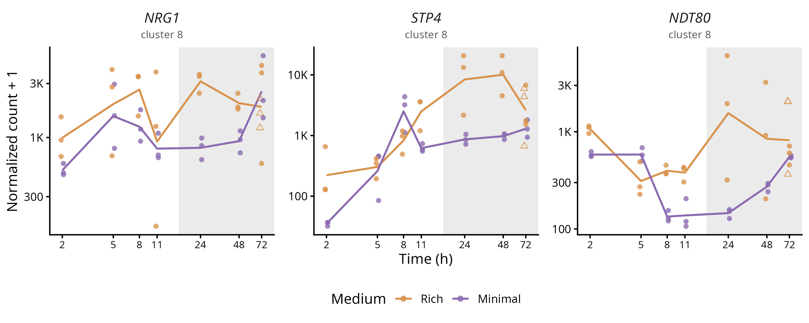

# Supplementary Figure 8. Expression of *NRG1*, *STP4* and *NDT80* over the time course in rich and minimal medium

**Status:** Reproducible (resubmission draft) – see `Supplementary_Figure_08_genes_of_interest.Rmd`

## Legend

**Supplementary Figure 8. Expression of *NRG1*, *STP4* and *NDT80* over the time course in rich and minimal medium.** DESeq2-normalized counts (+1, log10 scale) of the transcription factor genes *NRG1*, *STP4* and *NDT80* (knocked out in Figure 6) in wild-type SC5314 grown in rich (YPD) or carbon-limited minimal medium. Points are biological replicates; lines join the mean of the log-scaled values at each time point. Time is on a log2 scale. The shaded area marks the quiescent phase (24–72 h). Triangles are the additional rich 72 h libraries from a second sequencing run (HJT3JDRX7), which have low mRNA depth. The temporal cluster of each gene (Supplementary Figure 9, Figure 4B) is given under its name.

## Panels

| Panel | Content | Code | Input data | Status |
|---|---|---|---|---|
| (single panel) | *NRG1* (C7_04230W_A), *STP4* (C2_03220C_A), *NDT80* (C2_00140W_A): normalized counts over time, rich vs minimal | `Supplementary_Figure_08_genes_of_interest.Rmd` | `data/normalized_counts.csv.gz`, `data/timecourse_gene_clusters.csv` | Reproducible |

## How to run

From this folder: `Rscript -e 'rmarkdown::render("Supplementary_Figure_08_genes_of_interest.Rmd")'`. Outputs go to `output/`: the figure (`Supplementary_Figure_08.{pdf,png}`) and the plotted values (`Supplementary_Figure_08_counts.csv`).
Required packages: rmarkdown, data.table, ggplot2, ggtext, scales.

## Notes

- The data files are outputs of `CandidaTFKO5_WT_72h/analysis/WT_Rich_vs_Minimal_timecourse_DESeq2_ORA.Rmd` (`new_72h_mode = "add"`, `n_clusters = 8`). The figure is that analysis' "Genes of interest" plot, restyled; the analysis itself was not changed. The genes are set by the Rmd parameter `genes`.
- Revision: following the reviewer's request, the figure now shows only *NRG1*, *STP4* and *NDT80* (the three transcription factors knocked out in Figure 6) as a single panel, and the former panel B (carbon metabolism genes) and the other panel A genes (*EFG1*, *TUP1*, *HWP1*, *ALS3*) were removed. All three genes are in temporal cluster 8; a gene without a cluster would be labelled "not clustered".
- What changed from the analysis plot: the strips give each gene's cluster, and replicates are dodged by medium rather than randomly jittered. The y values, the mean line (mean of log10(count + 1), as `stat_summary` on a log10 axis) and the quiescent shading are unchanged.
- *NRG1* is time-responsive only in minimal medium (LRT padj < 0.05); *STP4* and *NDT80* in both media, and both have a significant medium × time interaction (padj 6.4e-7 and 7.3e-6).
- The rich 72 h means include the three HJT3JDRX7 libraries, as in the analysis. These libraries are ~99% rRNA (roughly 50–80 thousand mRNA counts each), so their normalized counts are noisy.
- Medium colours use the Figure 4 hues, with minimal darkened from the Figure 4 annotation colour so the lines are legible.
- This replaces the original-submission Supplementary Figure 8 (GO over-representation dotplots of the eight expression clusters). The cluster ORA is now Supplementary Figure 9, and the original code (`geneset_analysis_figure2.Rmd`) moved there for reference.
